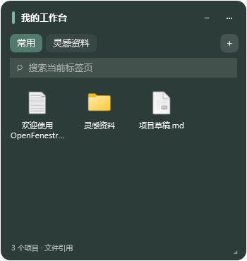

# OpenFenestra

**桌面，自有条理。** 一个受 Fences 启发、独立实现的开源 Windows 桌面图标整理工具。

Native Windows desktop organizer built with C#, WPF and .NET 10. Open source under MIT.

> v0.1.0 学习实践版。可实际运行，支持文件引用和文件夹面板；尚未实现 Fences 的原生桌面图标接管。




## 已实现

- **分组面板**：创建、重命名、拖动、调整大小、锁定、颜色、不透明度、隐藏和折叠。
- **标签页**：同一面板中切换多个普通收纳页或文件夹映射页。
- **收纳文件引用**：拖入文件、文件夹或快捷方式，双击或 Enter 打开，右键定位或移动引用到其他分组。
- **实时文件夹**：显示文件夹内容，通过 `FileSystemWatcher` 自动刷新；映射页只读浏览。
- **一键归类桌面**：按应用、文档、图片、文件夹、影音等类型建立分组；可监听新增桌面项目。
- **搜索**：面板筛选当前标签页，管理窗口筛选分组和标签页名称。
- **布局管理**：自动保存、原子写入、上一版备份、快照、JSON 导入导出、损坏恢复。
- **系统托盘与速览**：关闭管理窗口后继续运行；`Ctrl+Alt+Space` 切换分组置顶。
- **实验桌面层**：通过 Win32 调整本程序面板的窗口顺序，定期保持在 Explorer 桌面附近。

## 运行

支持 Windows 10/11 x64。便携版内置 .NET，无需管理员权限。

1. 在 [Actions](https://github.com/Alan-R-Lee/OpenFenestra/actions) 下载 `OpenFenestra-win-x64` 构建产物，或自行构建。
2. 解压到一个普通文件夹，运行 `OpenFenestra.exe`。
3. 点击“新建分组”，把文件拖入面板；或点击“一键归类桌面”。
4. 面板上的 `+` 添加标签页；右键标签页编辑并选择映射文件夹。
5. 右键托盘图标退出程序。关闭管理窗口会收起到托盘。

程序默认把布局保存在 `%LOCALAPPDATA%\OpenFenestra`。`layout.json.bak` 是上一次成功保存的布局，`snapshots` 存放快照。

```powershell
# 指定独立数据目录，适合调试；不要让多个实例共用同一目录
.\OpenFenestra.exe --data-dir "D:\OpenFenestra-Test"

# 仅启动面板和托盘
.\OpenFenestra.exe --tray
```

## 从源码构建

安装 [.NET 10 SDK](https://dotnet.microsoft.com/download/dotnet/10.0)，在 Windows PowerShell 中运行：

```powershell
dotnet build OpenFenestra.sln -c Release
dotnet run --project tests/OpenFenestra.Tests -c Release
dotnet run --project src/OpenFenestra.App -c Release

# 生成内置运行时的 x64 便携版与 ZIP
.\scripts\build.ps1
```

也可以在 Visual Studio 中打开 `OpenFenestra.sln`。应用使用 WPF，不能在 Linux/macOS 上运行。

## 数据行为

- 拖入只添加路径引用，**不会移动、复制或删除原文件**。
- 移除分组、标签页或项目只修改本程序布局。移除分组、标签页前自动保存快照。
- 文件夹映射只列出当前层级，不递归扫描；不把拖入内容写进文件夹。
- 原文件移动或删除后引用仍保留，以较低不透明度显示；不会擅自清理文件。
- 快照和导出文件保存的是布局和路径，**不是文件内容备份**。
- 选择“打开”会由 Windows 默认关联程序处理文件和快捷方式。
- 无遥测、账号、云同步或后台网络请求；.NET 构建过程需要下载官方运行时依赖。

## 当前边界

- 原生桌面图标仍保留。此版本管理的是独立面板内的文件引用，不会隐藏 Explorer 图标，也不注入 Explorer。
- 桌面层是实验性窗口层级定位；Explorer 重启、显示桌面、虚拟桌面、混合 DPI/多显示器切换仍需更多兼容性验证。默认关闭。
- 单个标签页最多 10,000 项，界面最多显示搜索结果前 300 项；建议用搜索或多个标签页缩小范围。
- 文件夹不可访问时展示不可用提示；重新连接后可从面板菜单刷新。
- 自动归类处理启动监听后的新增/重命名事件；既有内容需要点击“一键归类桌面”。
- 尚无安装器、签名、自动更新、自定义分类规则、原生 Explorer 右键菜单和回收站等虚拟 Shell 项目支持。

## 学习与贡献

- [调研记录与来源](docs/RESEARCH.md)：本机 Fences 6 文件观察、官方功能与社区开源实现。
- [架构与设计](docs/ARCHITECTURE.md)：数据模型、存储、文件安全和窗口集成。
- [手动验收清单](docs/TESTING.md)：交互、桌面兼容性和恢复测试。
- [第三方说明](THIRD_PARTY_NOTICES.md)：调研项目与许可证记录。

本项目与 Stardock 没有隶属或合作关系。Fences 是相应权利人的商标。本仓库不包含 Fences 的程序、源码、图片、布局素材、授权文件或反编译结果。

## License

[MIT](LICENSE) © 2026 Alan-R-Lee and contributors.
